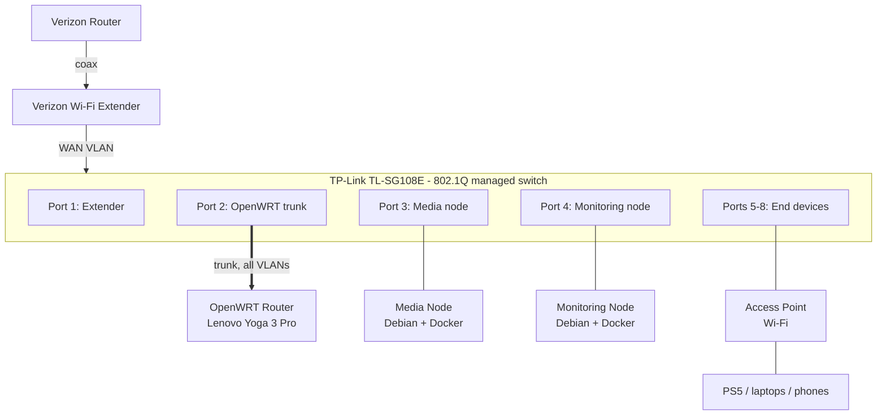
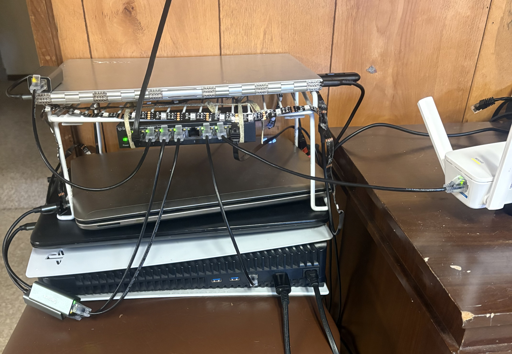

# Homelab Infrastructure

A self-hosted lab built for hands-on practice with Linux servers, containers, monitoring, and enterprise-style network segmentation. It runs on repurposed laptops and a small managed switch, and is documented here as I build and change it.

**What this lab demonstrates**

- Network segmentation with 802.1Q VLANs and an OpenWRT router-on-a-stick design
- Containerized services managed with Docker Compose on Debian
- Monitoring and alerting with Prometheus, Grafana, and Uptime Kuma
- Secure remote access with Tailscale
- Troubleshooting and documenting real failures (see [Lessons Learned](#lessons-learned))

---

## Architecture



All inter-VLAN routing, DHCP, and firewalling happen on the OpenWRT router over a single physical trunk link to the switch. The existing home network is untouched: the lab sits behind the router and reaches the internet through the extender.

## Picture of Homelab 



---

## Hardware

| Role | Device | Notes |
|------|--------|-------|
| Media node | HP Notebook 15 Laptop (8GB Ram) (2016) | Debian 13 (Trixie), Docker Compose |
| Monitoring node | HP Pavilion DM4 Laptop (6 GB Ram) (2011) | Debian 13 (Trixie), Docker Compose |
| Router | Lenovo Yoga 3 Pro (Core M5Y71, 8 GB RAM) | OpenWRT 25.12, booted from a USB 3 drive, USB 3 gigabit Ethernet adapter as the trunk interface |
| Switch | TP-Link TL-SG108E | 8-port gigabit managed switch, 802.1Q VLANs |
| Access point | Linksys Wi-Fi Extender (RE6300) | Wi-Fi for end devices |
| Uplink | Verizon Wi-Fi extender | Wired to the Verizon router over coax; acts as the lab's internet source |
| Gaming | PlayStation 5 | On the end-devices VLAN, used with Remote Play |

---

## Network

### VLANs

| VLAN | Name | Subnet | Members | Policy |
|------|------|--------|---------|--------|
| 10 | WAN | n/a | Extender uplink | Untagged to the extender port only |
| 20 | Servers | 10.0.20.0/24 | Media node, monitoring node | Internet access; cannot reach the router or end devices |
| 1 | End devices | 10.0.1.0/24 | Laptop, access point clients, PS5 | Internet access; can reach servers as needed |

### Switch port map (TL-SG108E)

| Port | Connected to | VLAN mode |
|------|--------------|-----------|
| 1 | Verizon extender | WAN, untagged |
| 2 | OpenWRT router | 802.1Q trunk (all VLANs tagged) |
| 3 | Media node | Servers, untagged |
| 4 | Monitoring node | Servers, untagged |
| 5 | spare port | End devices, untagged |
| 6 | PS5 for remote play | End devices, untagged |
| 7 | Access point (linksys wifi extender) | End devices, untagged | 
| 8 | Main laptop | End devices, untagged |

### Router (OpenWRT)

- **Design:** router-on-a-stick. One USB 3 gigabit adapter carries every VLAN as tagged sub-interfaces; OpenWRT does inter-VLAN routing and NAT.
- **Firewall:** separate zones per VLAN. The servers VLAN is isolated from the router and from end devices, with exceptions opened only for troubleshooting.
- **Throughput:** iperf3 measured about 950 Mbit/s router-to-server and laptop-to-server, so the single-link design is not a bottleneck on gigabit.
- **Wi-Fi:** provided by a dedicated access point on the end-devices VLAN 

### Remote access

Tailscale provides access to the servers from outside the network. Services that don't need to be public are reachable only over the tailnet.

---

## Servers

### Media node

Runs on Debian 13 with Docker Compose. Each stack has its own compose file and an `.env` file for configuration (examples in [`media-node/`](media-node/)).

| Service | Purpose |
|---------|---------|
| Jellyfin | Media streaming |
| Nextcloud (with PostgreSQL and Redis) | File storage and sync, also used to share media files to other devices |
| Vaultwarden | Self-hosted password manager |
| n8n | Workflow automation |
| Homepage | Dashboard linking all services |
| Tailscale | Remote access |

### Monitoring node

Runs on Debian 13 with Docker Compose (see [`monitoring-node/`](monitoring-node/)).

| Service | Purpose |
|---------|---------|
| Prometheus | Metrics collection |
| Grafana | Dashboards |
| Uptime Kuma | Service uptime checks and alerts |

<!-- TODO: add exporters you actually run (node-exporter, cAdvisor, etc.) and what each scrapes. Add a Grafana screenshot to /images. -->

---

## Repository layout

```
homelab-infrastructure/
├── README.md
├── docs/
│   ├── network.md           # VLAN design, addressing, firewall rules
│   ├── router-openwrt.md    # router-on-a-stick setup walkthrough
│   └── remote-play.md       # PS5 Remote Play setup
├── media-node/              # compose files + .env.example
├── monitoring-node/         # compose files + Prometheus/Grafana config
├── router/                  # sanitized OpenWRT configs
├── switch/                  # TL-SG108E VLAN/port settings
└── images/                  # diagrams and photos
```

---

## Lessons Learned

- **Config before cable.** Plugging the OpenWRT router into the switch while it still used the Verizon router's default IP caused an address conflict and took down the household network for about 10 minutes. I now verify addressing and DHCP settings on an isolated port before connecting anything to the live network.
- **USB NICs need care.** The USB 3 Ethernet adapter on the router sometimes negotiates at USB 2 speed until it is fully unplugged and reseated. Verifying link speed with iperf3 after any change catches this.
- **Containers talk by name, not IP.** Compose networks resolve service names, which avoids breakage when addresses change.
- **UID mismatches cause permission errors.** Bind-mounted data directories must match the container user's UID/GID.
- **YAML indentation fails silently** in some configs (Homepage in particular), so I validate before restarting.

---

## Security note

No secrets are committed to this repository. Compose files use `.env.example` templates with placeholder values, and credentials, API keys, Wi-Fi passphrases, and Tailscale identifiers are excluded.

---

## About

Built and maintained by Jonathon Locke
[LinkedIn](https://linkedin.com/in/jonathon-locke-5a68a0212) · [GitHub](https://github.com/jjlocke2004)
