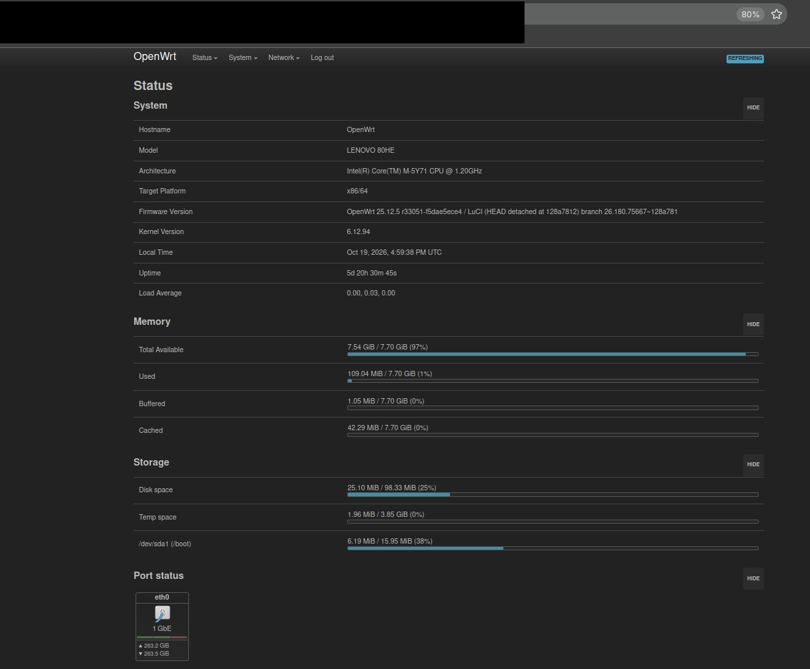
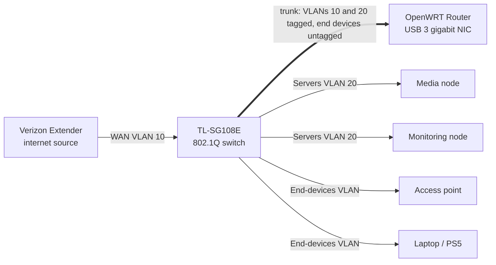
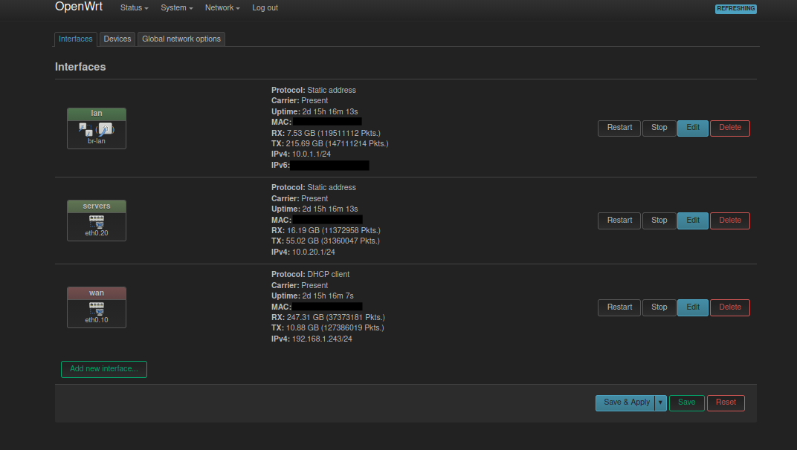
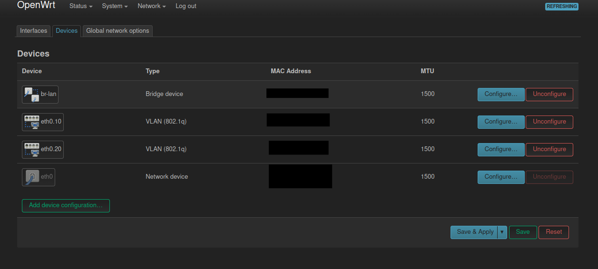
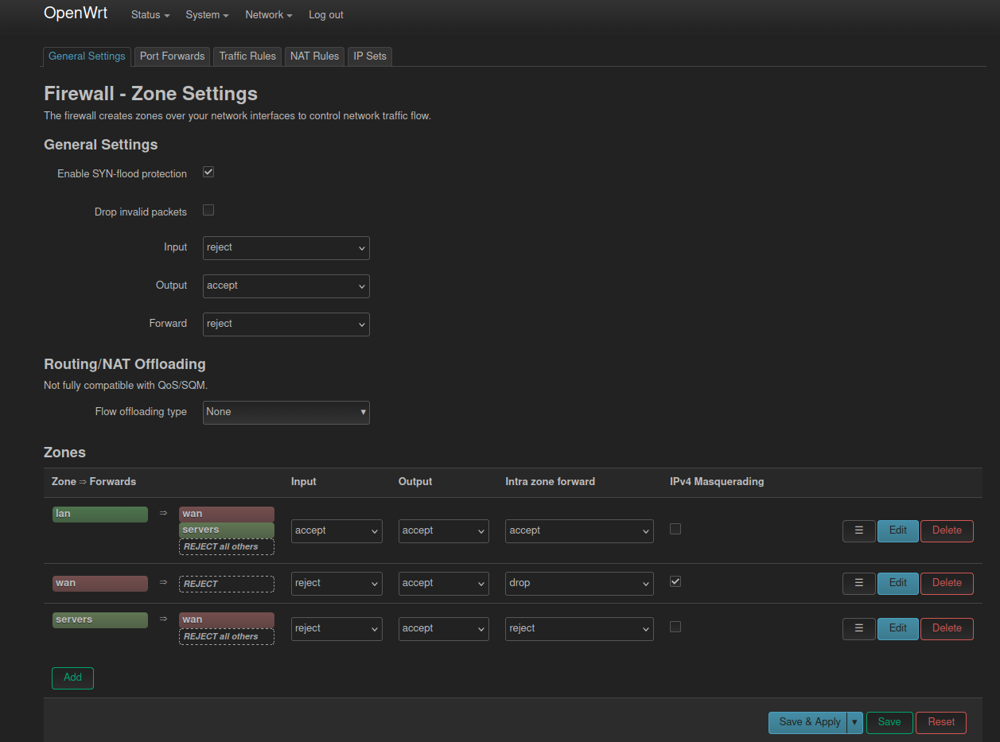

# OpenWRT Router (Router-on-a-stick)

This document describes the lab's router: an OpenWRT x86 machine that performs all the inter-VLAN routing, DHCP, and firewalling over a single physical link to a managed switch. Sanitized config exports are in [`router/`](../router/).

## Overview

| | |
|---|---|
| **Hardware** | Lenovo Yoga 3 Pro (Core M-5Y71, 8 GB RAM) |
| **OS** | OpenWRT 25.12.5 (x86/64), booted from a USB 3 drive (ext4 EFI image) |
| **Trunk interface** | USB 3 gigabit Ethernet adapter (`eth0`) |
| **Switch** | TP-Link TL-SG108E (802.1Q VLANs) |
| **Uplink** | Verizon Wi-Fi extender (wired to the Verizon router over coax) |
| **Goal** | Isolate the lab from the home network and practice enterprise-style segmentation on real hardware |

## Why router-on-a-stick

The laptop has no built-in Ethernet port, so its only physical interface is a USB 3 adapter. The adapter carries all lab traffic to the switch over one link: VLANs 10 (WAN) and 20 (servers) as 802.1Q-tagged traffic, and the end-devices network as the untagged (native) VLAN. OpenWRT creates a sub-interface for each tagged VLAN, a bridge for the untagged one, and routes between them.

It is also the same design I previously built in Cisco Packet Tracer for CCNA study, so this lab was a way for me to do it on real hardware.

## Network design

| VLAN | Purpose | Subnet | Router address | On the trunk |
|------|---------|--------|----------------|--------------|
| 10 | WAN (extender uplink) | DHCP from the extender | n/a | Tagged (`eth0.10`) |
| 20 | Servers | 10.0.20.0/24 | 10.0.20.1 | Tagged (`eth0.20`) |
| 1 | End devices | 10.0.1.0/24 | 10.0.1.1 | Untagged (`br-lan`) |

The Devices page shows the bridge for the end-devices network and one 802.1Q sub-interface per tagged VLAN, all on `eth0`:

### Switch port map (TL-SG108E)

| Port | Connected to | VLAN mode |
|------|--------------|-----------|
| 1 | Verizon extender | WAN (VLAN 10), untagged |
| 2 | OpenWRT router | 802.1Q trunk: VLANs 10 and 20 tagged, VLAN 1 untagged |
| 3 | Media node | Servers (VLAN 20), untagged |
| 4 | Monitoring node | Servers (VLAN 20), untagged |
| 5 | Spare port | End devices, untagged |
| 6 | PS5 for Remote Play | End devices, untagged |
| 7 | Access point (Linksys Wi-Fi extender) | End devices, untagged |
| 8 | Main laptop | End devices, untagged |

### Firewall policy

The firewall uses one zone per network. The servers zone rejects all input and forwarding, except traffic to the WAN, so a server can reach the internet but nothing else on the lab network.

- The **servers VLAN cannot reach the router or the end-devices VLAN.** If a server is compromised, it has no path to the devices people actually use.
- The **end-devices VLAN can reach the servers** to use the services and for administration.
- Both networks reach the internet through NAT on the WAN interface.
- Traffic to the router from the servers VLAN, including ICMP to `10.0.20.1`, is rejected by default and can be opened temporarily when troubleshooting.

## Installation notes

1. **Use the EFI image unless the device is really old.** I first used the legacy BIOS ext4 image because I was originally going to use the older HP laptop as the router instead of the Lenovo. I forgot to switch to the EFI image, which caused boot problems.
2. **Set the LAN address before connecting to anything.** Change OpenWRT's default address first. Otherwise it uses the same address most home routers use by default, which conflicts with the main network you are trying to segment from. (I learned this one from experience.)
3. **Create the VLAN sub-interfaces** on the trunk device, one per tagged VLAN, each with its own address. Servers (VLAN 20) gets a static address and DHCP pool; WAN (VLAN 10) is a DHCP client from the extender. The end-devices network is the untagged bridge.
4. **Configure the switch** with matching 802.1Q VLANs and port memberships. Port 2 is a tagged member of VLANs 10 and 20 and an untagged member of VLAN 1.
5. **Assign firewall zones** per network and write the forwarding rules.

Relevant config excerpts: [`router/network.uci`](../router/network.uci), [`router/firewall.uci`](../router/firewall.uci), [`router/dhcp.uci`](../router/dhcp.uci).

## Verification

| Test | Result |
|------|--------|
| Laptop on end-devices VLAN gets a `10.0.1.x` DHCP lease | Pass |
| Server on servers VLAN gets a `10.0.20.x` DHCP lease | Pass |
| Both networks have internet access through the extender | Pass |
| Servers VLAN cannot reach the router or end devices | Pass |
| iperf3, router to media server | ~950 Mbit/s |
| iperf3, laptop to media server | ~950 Mbit/s |

The iperf3 results show that routing all VLANs over one gigabit trunk is not a bottleneck for this lab's traffic.

## Troubleshooting and lessons learned

### Address conflict took down the household network
When I first connected the router to the switch, it still used the same default IP as the Verizon router. Two devices claiming the same address on the live network took the household's connectivity offline for about 10 minutes, and family TVs needed network resets. I disconnected everything and power-cycled the extender and router to recover.

**Takeaway:** change addressing and DHCP while the device is isolated, and verify the configuration before plugging into anything shared. I now configure new network gear on a standalone port first.

### USB adapter negotiates at the wrong speed
The USB 3 Ethernet adapter sometimes links at USB 2 speed until it is fully unplugged and reseated. I check link speed (and run an iperf3 test) after any hardware change.

### Boot media had to match the firmware
The legacy BIOS image would not appear as a boot option on this laptop's firmware. Matching the image type (EFI) to what the hardware supports fixed it.

## Possible improvements

- A guest VLAN
- DNS filtering
- Prometheus exporter on the router
- Moving end devices off VLAN 1

## Related

- [Router config exports](../router/)
- [Main README](../README.md)
